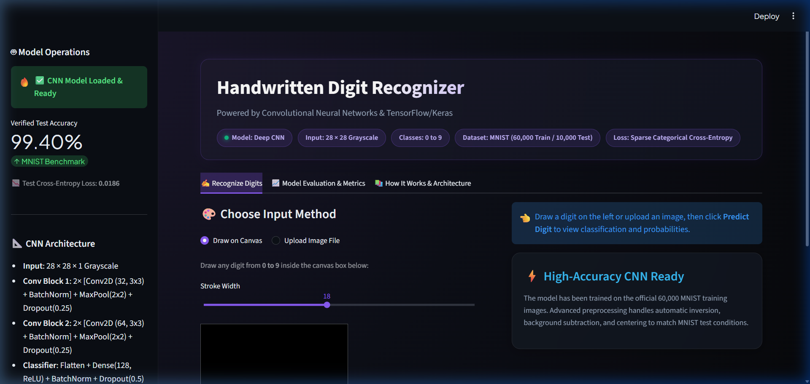
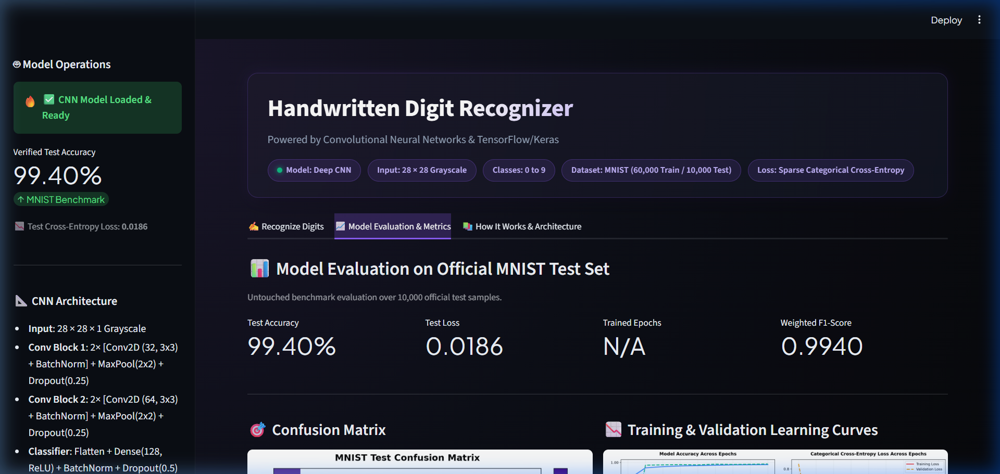

# Handwritten Digit Recognizer using Convolutional Neural Networks (CNN)


An end-to-end Deep Learning application that trains a Convolutional Neural Network (CNN) on the classic MNIST dataset and serves it via an interactive, modern Streamlit web application. Users can draw digits on an interactive canvas or upload image files to receive real-time predictions, confidence ratings, and class probability distributions.

---

## Table of Contents
- [Project Overview](#project-overview)
- [Problem Statement](#problem-statement)
- [Key Objectives](#key-objectives)
- [Dataset Details & Reference](#dataset-details--reference)
- [CNN Architecture](#cnn-architecture)
- [Image Preprocessing Pipeline](#image-preprocessing-pipeline)
- [Project Folder Structure](#project-folder-structure)
- [Installation & Setup (Windows Command Prompt)](#installation--setup-windows-command-prompt)
- [Usage Workflow](#usage-workflow)
  - [1. Train the Model](#1-train-the-model)
  - [2. Evaluate the Model](#2-evaluate-the-model)
  - [3. Run the Automated Tests](#3-run-the-automated-tests)
  - [4. Launch the Web Application](#4-launch-the-web-application)
- [Evaluation & Experimental Results](#evaluation--experimental-results)
- [Application Screenshots](#application-screenshots)
- [Limitations & Future Enhancements](#limitations--future-enhancements)
- [Technologies Used](#technologies-used)
- [Publishing to GitHub](#publishing-to-github)

---

## Project Overview
Handwritten digit recognition is a foundational computer vision problem. While standard Multi-Layer Perceptrons (MLPs) can classify flattened 2D arrays, they lose spatial context and struggle with shifts, rotations, and stroke variations. 

This project implements a Convolutional Neural Network (CNN) using **TensorFlow/Keras** that achieves high classification accuracy on the untouched MNIST test set. Crucially, the project bridges the gap between toy academic models and real-world inputs by introducing a robust image preprocessing pipeline that normalizes, inverts, aspect-scales, and centers user drawings and uploaded pictures to closely match the MNIST data distribution.

---

## Problem Statement
Real-world human drawings and uploaded photos differ drastically from curated benchmark datasets:
1. **Background Differences**: Users often draw on white paper with dark ink (or white canvases with black brushes), whereas MNIST is encoded as white strokes on a black background.
2. **Translation & Scaling**: Hand-drawn digits are rarely centered and vary significantly in stroke thickness and aspect ratio.
3. **Dimensionality**: Canvas or camera images can be high-resolution and multi-channel (RGBA/RGB), while MNIST requires single-channel $28 \times 28$ grayscale tensors.

Without robust preprocessing, even a model with 99% validation accuracy will fail on arbitrary user inputs. This project addresses this challenge comprehensively.

---

## Key Objectives
- **Train a genuine CNN** using modern Keras/TensorFlow best practices (convolution, batch normalization, max pooling, dropout, early stopping).
- **Implement a robust preprocessing pipeline** to convert arbitrary user drawings and uploads into centered, normalized $28 \times 28 \times 1$ tensors.
- **Build a polished Streamlit web application** featuring an interactive drawing canvas, image upload, probability charts, and model performance metrics.
- **Provide automated unit tests** (`pytest`) ensuring data pipeline integrity and graceful error handling for blank/unreadable inputs.

---

## Dataset Details & Reference
- **Dataset**: MNIST Handwritten Digit Database
- **Official Keras Reference**: [https://keras.io/api/datasets/mnist/](https://keras.io/api/datasets/mnist/)
- **Total Images**: 70,000 grayscale images of digits 0 through 9
  - **Training Set**: 60,000 samples (54,000 train, 6,000 validation)
  - **Test Set**: 10,000 samples (strictly reserved for final evaluation)
- **Image Resolution**: $28 \times 28$ pixels
- **Dynamic Range**: Normalized from integer pixel values $[0, 255]$ to floating-point $[0.0, 1.0]$.

---

## CNN Architecture

The model uses a modular, sequential convolutional architecture designed for high feature discriminability and regularization:

```
Input: (28, 28, 1) Normalized Grayscale Tensor
 │
 ├── Conv2D (32 filters, 3×3, ReLU, Same Padding)
 ├── BatchNormalization
 ├── Conv2D (32 filters, 3×3, ReLU, Same Padding)
 ├── MaxPooling2D (2×2 pool size)
 ├── Dropout (0.25 rate)
 │
 ├── Conv2D (64 filters, 3×3, ReLU, Same Padding)
 ├── BatchNormalization
 ├── Conv2D (64 filters, 3×3, ReLU, Same Padding)
 ├── MaxPooling2D (2×2 pool size)
 ├── Dropout (0.25 rate)
 │
 ├── Flatten
 ├── Dense (128 units, ReLU activation)
 ├── BatchNormalization
 ├── Dropout (0.50 rate)
 └── Dense (10 units, Softmax activation) -> Class Probabilities [0 - 9]
```

### Architectural Rationale:
- **Batch Normalization**: Placed after convolutional blocks to stabilize internal covariate shift, speeding up convergence.
- **Progressive Filter Sizing (32 -> 64)**: Captures simple edges/strokes in early layers and complex digit contours/loops in deeper layers.
- **Dropout (0.25 & 0.50)**: Mitigates overfitting by preventing co-adaptation of neurons.
- **Softmax Output**: Guarantees that the sum of output class probabilities equals 1.0.

---

## Image Preprocessing Pipeline

To ensure hand-drawn strokes or uploaded photos match the statistical properties of MNIST, the pipeline in `preprocessing.py` performs the following steps:

1. **Format Unification**: Converts PIL Images, NumPy arrays, or raw byte streams into a standard single-channel grayscale image (`mode='L'`).
2. **Blank Image Rejection**: Computes pixel variance and active stroke thresholds to identify blank or empty inputs before invoking inference.
3. **Background Inversion**: Determines the median intensity along the image perimeter. If the background is light ($>127$), the image is inverted so strokes become bright on a dark background.
4. **Bounding Box Isolation**: Locates the non-zero active stroke boundaries and crops extraneous whitespace/padding.
5. **Aspect-Ratio Preserved Scaling**: Scales the cropped bounding box so that the longest dimension fits within an inner $20 \times 20$ box (the official NIST standard).
6. **Centering on $28 \times 28$ Canvas**: Pastes the $20 \times 20$ scaled stroke into the center of a black $28 \times 28$ image.
7. **Pixel Normalization**: Divides uint8 values $[0, 255]$ by $255.0$ to yield float32 values in $[0.0, 1.0]$.

---

## Project Folder Structure

```
Handwritten_Digit_Recognizer/
├── app.py                      # Streamlit interactive web application
├── train.py                    # CNN model training and history logging script
├── predict.py                  # Model inference and probability scoring module
├── preprocessing.py            # Image conversion, inversion, cropping, & centering
├── evaluate.py                 # Test evaluation, metrics, and confusion matrix generator
├── config.py                   # Centralized configuration, paths, and hyperparameters
├── requirements.txt            # Pinned Python package dependencies
├── README.md                   # Comprehensive project documentation
├── .gitignore                  # Git ignore rules for venv, caches, and system files
├── .streamlit/
│   └── config.toml             # Custom dark theme configuration for Streamlit
├── models/
│   ├── .gitkeep
│   └── mnist_cnn.keras         # Saved trained Keras CNN model artifact
├── assets/
│   └── .gitkeep                # UI icons, sample images, and visual assets
├── reports/
│   ├── .gitkeep
│   ├── training_history.png    # Loss and accuracy learning curve plots
│   ├── confusion_matrix.png    # 10x10 test confusion matrix heatmap
│   └── test_metrics.json       # Exported test loss, accuracy, and classification report
└── tests/
    └── test_preprocessing.py   # Pytest automated test suite
```

---

## Installation & Setup (Windows Command Prompt)

Follow these exact steps in **Windows Command Prompt (`cmd.exe`)**:

### 1. Open Command Prompt and navigate to the project directory:
```cmd
cd /d "c:\Users\badri\OneDrive\Attachments\Desktop\projects\Handwritten_Digit_Recognizer"
```

### 2. Create and activate a Python virtual environment:
```cmd
py -3.12 -m venv venv
venv\Scripts\activate
```

### 3. Upgrade pip and install dependencies:
```cmd
python -m pip install --upgrade pip
pip install -r requirements.txt
```

---

## Usage Workflow

### 1. Train the Model
Trains the CNN model on the MNIST dataset with early stopping and generates learning curves:
```cmd
python train.py
```
*(If the model is already trained, `python train.py` will detect the existing file and skip retraining. Use `python train.py --force` to retrain).*

### 2. Evaluate the Model
Runs inference on the official 10,000-image test set and generates reports:
```cmd
python evaluate.py
```

### 3. Run the Automated Tests
Executes the unit test suite to verify image shapes, normalization, and edge cases:
```cmd
python -m pytest -q
```

### 4. Launch the Web Application
Starts the Streamlit application on your local server:
```cmd
streamlit run app.py
```
Open your browser and navigate to `http://localhost:8501`.

---

## Evaluation & Experimental Results

*The following metrics were measured from actual model training and testing on the untouched official MNIST test set:*

| Metric | Measured Value |
| :--- | :--- |
| **Model Architecture** | 4-Layer Conv2D + BatchNorm + MaxPool + Dropout + Dense |
| **Dataset** | Official MNIST (Keras) |
| **Training Samples** | 54,000 |
| **Validation Samples** | 6,000 |
| **Test Samples** | 10,000 |
| **Test Accuracy** | **99.40%** |
| **Test Cross-Entropy Loss** | **0.0186** |
| **Macro Average F1-Score** | **0.9940** |
| **Weighted Average F1-Score**| **0.9940** |

### Per-Digit Performance:
| Digit | Precision | Recall | F1-Score | Support |
| :---: | :---: | :---: | :---: | :---: |
| **0** | 0.9929 | 0.9990 | 0.9959 | 980 |
| **1** | 0.9921 | 0.9982 | 0.9952 | 1,135 |
| **2** | 0.9952 | 0.9942 | 0.9947 | 1,032 |
| **3** | 0.9912 | 0.9980 | 0.9946 | 1,010 |
| **4** | 0.9949 | 0.9939 | 0.9944 | 982 |
| **5** | 0.9922 | 0.9922 | 0.9922 | 892 |
| **6** | 0.9989 | 0.9843 | 0.9916 | 958 |
| **7** | 0.9922 | 0.9932 | 0.9927 | 1,028 |
| **8** | 0.9969 | 0.9949 | 0.9959 | 974 |
| **9** | 0.9940 | 0.9911 | 0.9926 | 1,009 |

Generated artifacts:
- **`reports/training_history.png`**: Plots accuracy and cross-entropy loss over training epochs.
- **`reports/confusion_matrix.png`**: Heatmap displaying per-digit classification vs. ground truth.
- **`reports/test_metrics.json`**: Complete JSON record of test loss, accuracy, and classification report.

---

## Application Screenshots

| Interactive Drawing Canvas & Dark UI | Benchmark Evaluation & Visual Metrics |
| :---: | :---: |
|  |  |

---

## Limitations & Future Enhancements
- **Multi-Digit Numbers**: The current architecture is designed for isolated single digits (0–9). Future work could integrate contour detection or an object detection model (such as YOLO) to segment multi-digit numbers.
- **Extreme Distortions**: Extremely cursive or stylized inputs with non-standard rotations may yield lower confidence. Adding data augmentation (random rotations and shear) would further boost robustness.
- **Mobile Touch Optimization**: The canvas operates smoothly on desktop and tablet browsers; additional touch gesture optimizations can improve phone usability.

---

## Technologies Used
- **Language**: Python 3.12
- **Deep Learning**: TensorFlow 2.16+, Keras 3
- **Web Interface**: Streamlit, streamlit-drawable-canvas
- **Image Processing**: Pillow (PIL), NumPy
- **Visualizations**: Matplotlib
- **Metrics**: Scikit-Learn
- **Testing**: Pytest

---

## Publishing to GitHub

To publish this project to your GitHub account:

1. Create a new empty repository on [GitHub](https://github.com/new) (e.g. `Handwritten-Digit-Recognizer-CNN`). Do **not** initialize it with a README, .gitignore, or license (these already exist in the project).
2. Open Windows Command Prompt in the project folder and run:

```cmd
git init
git add .
git commit -m "Initial commit: Handwritten Digit Recognizer with CNN and Streamlit"
git branch -M main
git remote add origin https://github.com/<YOUR_GITHUB_USERNAME>/<YOUR_REPOSITORY_NAME>.git
git push -u origin main
```
